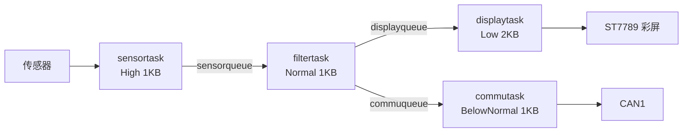

# P7 — STM32F407 + FreeRTOS 彩屏数据采集终端

> 在 P5 的四任务架构基础上换用 STM32F407VGT6，增加 ST7789 彩屏实时曲线
> 与 CAN 总线数据上报。

## 1. 项目简介

P5 在 STM32F103C8T6（64 KB Flash / 20 KB RAM）上验证了「采集 → 滤波 → 通信 → 显示」
四任务流水线。做到彩屏时遇到硬约束：240×240 RGB565 单帧约 112 KB，
已经超过 F103 的整片 RAM，更不用说再叠加 CAN/Modbus 协议栈。

因此本项目换用 **STM32F407VGT6**（1 MB Flash / 192 KB RAM），
**复用 P5 的任务划分与队列设计**，把重点放在人机界面与总线接口上：

- ST7789 240×240 IPS 彩屏，四参数数字显示 + 实时曲线
- CAN 标准帧周期上报（驱动已完成，待总线分析仪验证）
- Modbus RTU 从机（帧解析与 CRC16 已完成，待与上位机联调）

| 项 | 值 |
|---|---|
| MCU | STM32F407VGT6（Cortex-M4F，168 MHz） |
| RTOS | FreeRTOS（CMSIS-RTOS v2） |
| HAL | STM32Cube FW_F4 V1.28.3 |
| 构建 | CMake + Ninja + arm-none-eabi-gcc |
| 配置 | STM32CubeMX（`P7_F4_fourtasks.ioc`） |

## 2. 硬件与外设

| 外设 | 用途 | 接口 | 引脚 |
|---|---|---|---|
| ST7789 | 240×240 IPS 彩屏 | SPI3（仅发送） | SCK=PC10，MOSI=PC12，RST=PD0，DC=PD1，CS=PD2，BL=PD3 |
| DS18B20 | 温度 | 1-Wire | PB11 |
| MPU6050 | 三轴加速度 | I2C1 | SCL=PB6，SDA=PB7 |
| INA219 | 电流/电压 | I2C1 | SCL=PB6，SDA=PB7 |
| ADC1 | 模拟电压 | ADC | PA0（通道 0） |
| CAN1 | 数据上报 | CAN | TX=PA11，RX=PA12 |
| USART1 | Modbus RTU / 调试 | UART | TX=PA9，RX=PA10 |
| USART2 | 调试打印 | UART | TX=PA2，RX=PA3 |
| SWD | 下载调试 | SWD | PA13=SWDIO，PA14=SWCLK |

> I2C1 上挂两个从机，靠地址区分（MPU6050: 0x68，INA219: 0x40）。

## 3. 软件架构

| 任务 | 优先级 | 栈 | 职责 | 输出去向 |
|---|---|---|---|---|
| `sensortask` | High | 1 KB | 500 ms 周期采集四路数据 | `sensorqueue` |
| `filtertask` | Normal | 1 KB | 5 点滑动平均滤波 | `displayqueue`、`commuqueue` |
| `commutask` | BelowNormal | 1 KB | CAN 打包上报 | CAN1 |
| `displaytask` | Low | 2 KB | 彩屏刷新数字与曲线 | ST7789 |



**设计要点：**

1. 采集优先级最高，保证 500 ms 周期稳定
2. 显示优先级最低，彩屏刷屏再慢也不会拖累采样
3. 显示任务栈最大（2 KB），刷新函数调用链最深
4. 采集任务动态申请、消费任务独立释放，避免同一块内存进两个队列

## 4. 目录结构

```
P7_F4_fourtasks/
├── Core/
│   ├── app/
│   │   ├── drivers/        # can / modbus / st7789 / ds18b20 / mpu6050 / ina219 / fonts
│   │   ├── tasks/          # 四个任务实现
│   │   └── types/          # 公共数据类型
│   ├── Inc/                # CubeMX 生成的配置头文件
│   └── Src/                # 初始化代码 + freertos.c
├── cmake/                  # 交叉编译工具链
├── CMakeLists.txt
├── CMakePresets.json
├── P7_F4_fourtasks.ioc
├── STM32F407XX_FLASH.ld
└── startup_stm32f407xx.s
```

> 仓库**不包含** `Drivers/` 和 `Middlewares/`（约 55 MB 的 ST 官方代码），
> 由 CubeMX 按 `.ioc` 重新生成，见下一节。

## 5. 编译与烧录

### 第一步：生成依赖库

1. 用 **STM32CubeMX 6.x** 打开 `P7_F4_fourtasks.ioc`
2. `Project Manager` → `Toolchain / IDE` 选择 **CMake**
3. 点击 `GENERATE CODE`，生成 `Drivers/` 与 `Middlewares/`

> CubeMX 只在首次生成时创建 `CMakeLists.txt`，不会覆盖本仓库里已配置好的版本。

### 第二步：编译

```bash
cmake --preset Debug
cmake --build build/Debug
```

产物：`build/Debug/P7_F4_fourtasks.elf`

用 CLion 打开本目录也可以，选择 `Debug` 预设直接构建下载。

## 6. 彩屏实现要点

- **SPI3 仅发送模式**：屏幕只写不读，去掉 MISO，把 SPI 配成
  `SPI_DIRECTION_1LINE`，减少引脚占用
- **CPOL/CPHA**：ST7789 要求 `CPOL=High`、`CPHA=2Edge`，
  配错会出现花屏或点不亮
- **曲线区域**：y=80（顶）～230（底），共 150 像素
  - 温度：15 ℃ → y=230，50 ℃ → y=80
  - 电压：0 V → y=230，3.3 V → y=80
- **局部刷新**：只清除并重画曲线区域，不整屏填充，避免闪烁

## 7. 遇到的问题与解决

### 1. 屏幕点不亮 / 闪屏

**现象**：上电后屏幕全黑，或显示几秒后开始闪烁。

**原因**：SPI 配置成双向模式且 CPOL/CPHA 与 ST7789 要求不符，
数据在错误的时钟沿采样；另外背光引脚没有拉高。

**解决**：改为仅发送模式，修正 CPOL/CPHA，初始化后拉高背光（PD3）。

### 2. 一块内存进两个队列导致 Double Free

**现象**：运行一段时间后 HardFault，或显示数据变成乱码。

**原因**：采集任务 `malloc` 一块结构体，同时投递给 `displayqueue` 和
`commuqueue`，两个消费任务各自 `free`，同一块内存被释放两次。

**解决**：改为「拷贝分流」——每个队列各拿一份独立内存，
由各自的消费者释放，从根上消除重复释放。

### 3. 单总线时序被任务调度打断

**现象**：DS18B20 读数偶发失败。

**原因**：1-Wire 微秒级时序被 FreeRTOS 调度和中断打断。

**解决**：DWT 周期计数器做微秒级延时 + 临界区保护最短位操作区间。

> 代码中保留了若干注释掉的串口打印（`USART1`），
> 用于 CAN 分析仪未到位时观察数据，需要时取消注释即可。

## 8. 当前进度

| 功能 | 状态 |
|---|---|
| 四任务架构 + 队列 | ✅ 已实现 |
| 四路传感器采集 + 5 点滤波 | ✅ 已实现 |
| ST7789 数字显示 + 四路曲线 | ✅ 已实现 |
| DS18B20 自检函数（`DS18B20_SELFTEST` 宏） | ✅ 可用 |
| CAN 驱动封装 + 接入通信任务 | ⏳ 已实现，待总线分析仪验证 |
| Modbus RTU 从机（CRC16 / 保持寄存器） | ⏳ 帧解析完成，待与上位机联调 |

## 9. 第三方代码与许可

| 文件 | 来源 | 许可 | 修改 |
|---|---|---|---|
| `Core/app/drivers/st7789.c/.h` | [Floyd-Fish/ST7789-STM32](https://github.com/Floyd-Fish/ST7789-STM32) | GPL-3.0 | 适配 SPI3 与引脚；修正 CPOL/CPHA；集成到 displaytask |
| `Core/app/drivers/fonts.c/.h` | 同上（随驱动提供） | GPL-3.0 | 未修改 |
| `Drivers/`、`Middlewares/` | STMicroelectronics / FreeRTOS | BSD-3-Clause / MIT | 由 CubeMX 生成，不入库 |

本项目整体以 **GPL-3.0** 发布，详见 `LICENSE`。

## 10. 作者

王艳广 · 嵌入式方向 · 2027 届
GitHub：[@wangyanguang-embedded](https://github.com/wangyanguang-embedded)

> 前作：[P5 四任务数据采集系统](https://github.com/wangyanguang-embedded/p5-four-task)
